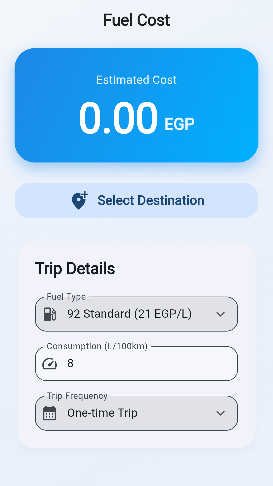
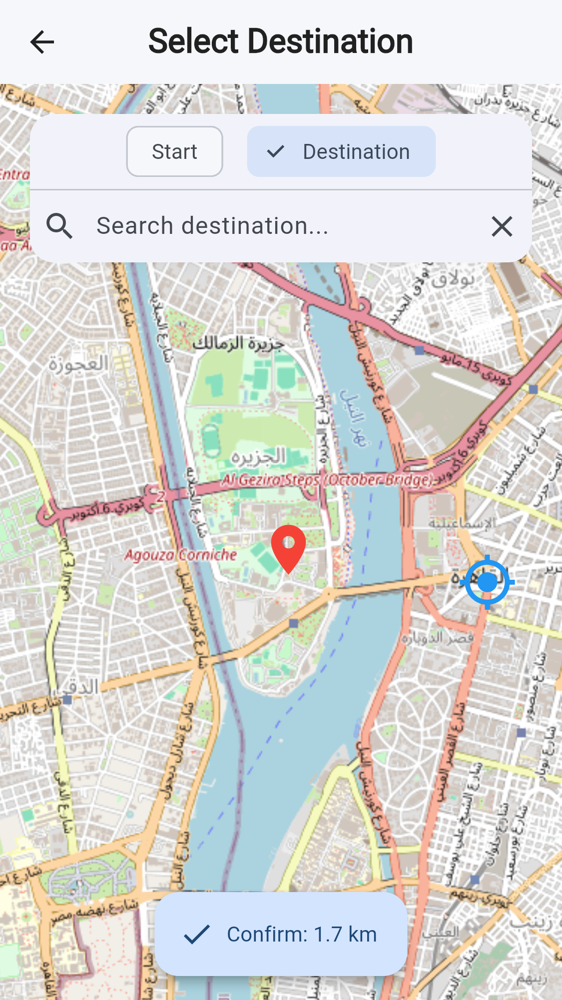
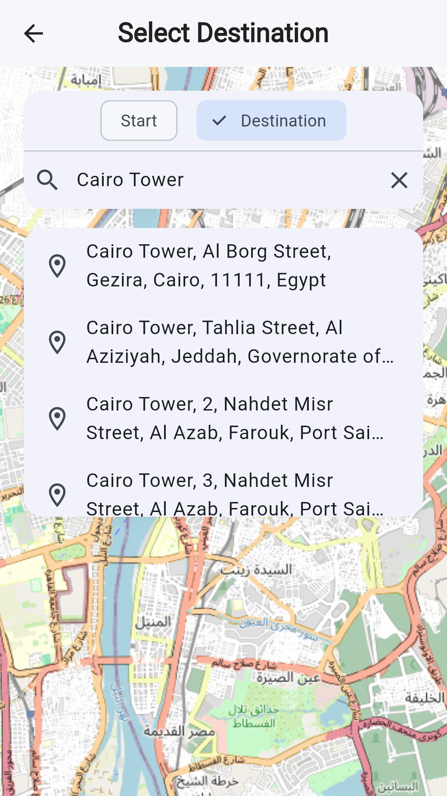
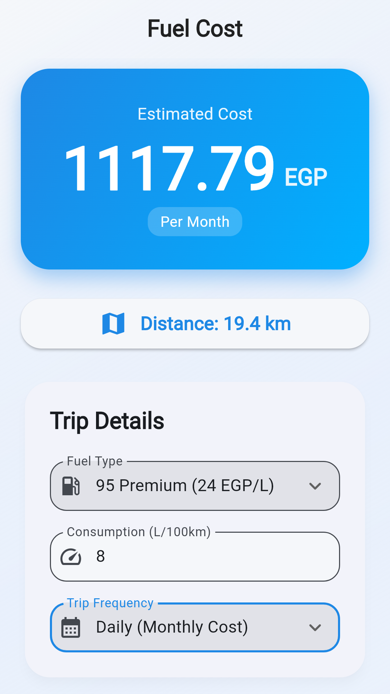
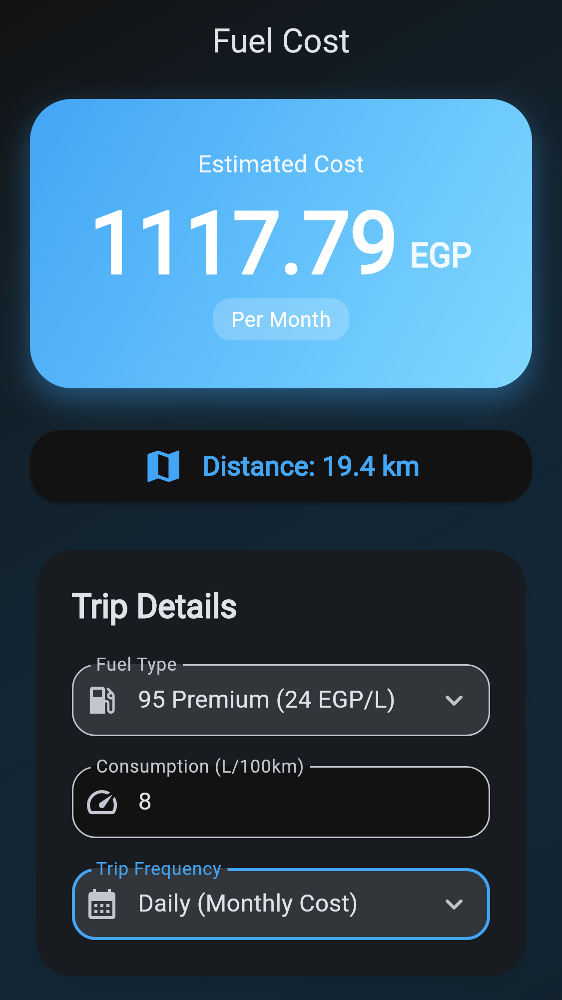
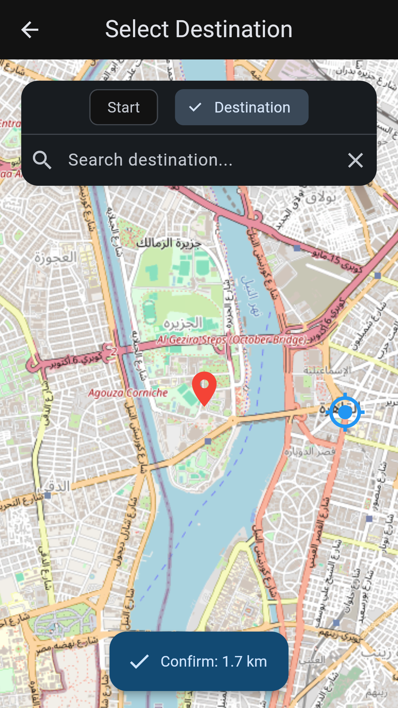

# Fuel Cost Calculator

A clean, modern Flutter application for estimating trip and monthly fuel costs in Egyptian Pounds (EGP) with interactive OpenStreetMap destination selection, live location search, and automatic road-distance routing.

## Screenshots

### Light Mode

| Home (Initial) | Map Destination Picker | Live Location Search | Calculated Monthly Cost |
| :---: | :---: | :---: | :---: |
|  |  |  |  |

### Dark Mode

| Calculated Monthly Cost (Dark) | Map Destination Picker (Dark) |
| :---: | :---: |
|  |  |

## Features

- **Instant Fuel Cost Calculation** — Calculates one-time, daily, weekly, and monthly fuel costs in EGP based on route distance, fuel octane type, and vehicle consumption (`L/100km`).
- **Fuel Type Presets** — Supports `92 Standard (21.0 EGP/L)` and `95 Premium (24.0 EGP/L)`.
- **Interactive Map Picker** — Powered by `flutter_map` and OpenStreetMap tiles with custom **Start** and **Destination** pin selection.
- **Live Location Search** — Integrated with OpenStreetMap Nominatim for quick place search.
- **Real Road Routing** — Uses OSRM (`router.project-osrm.org`) to compute driving distances between start and destination points.
- **Current Location Support** — Uses `geolocator` to detect the user's position (with Cairo as fallback).
- **Material 3 Light & Dark Themes** — Automatically adapts to system theme preferences.
- **Clean State Management** — Built with `flutter_bloc` (Cubit) and `equatable`.

## Tech Stack

- **Framework:** Flutter (Material 3)
- **State Management:** `flutter_bloc`, `equatable`
- **Maps & Location:** `flutter_map`, `latlong2`, `geolocator`
- **Networking & Routing:** `http`, OpenStreetMap Nominatim API, OSRM Routing API

## Getting Started

```bash
flutter pub get
flutter run
```

## Project Structure

```text
lib/
├── main.dart                         # App entry point & Light/Dark Material 3 themes
├── cubit/
│   ├── fuel_calculator_cubit.dart    # State updates for fuel type, consumption, distance & frequency
│   └── fuel_calculator_state.dart    # Immutable state & cost calculation logic
└── screens/
    ├── home_screen.dart              # Cost summary card & trip details form
    └── map_screen.dart               # Interactive map, Nominatim search & OSRM routing
```
